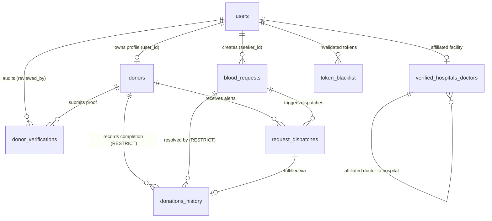
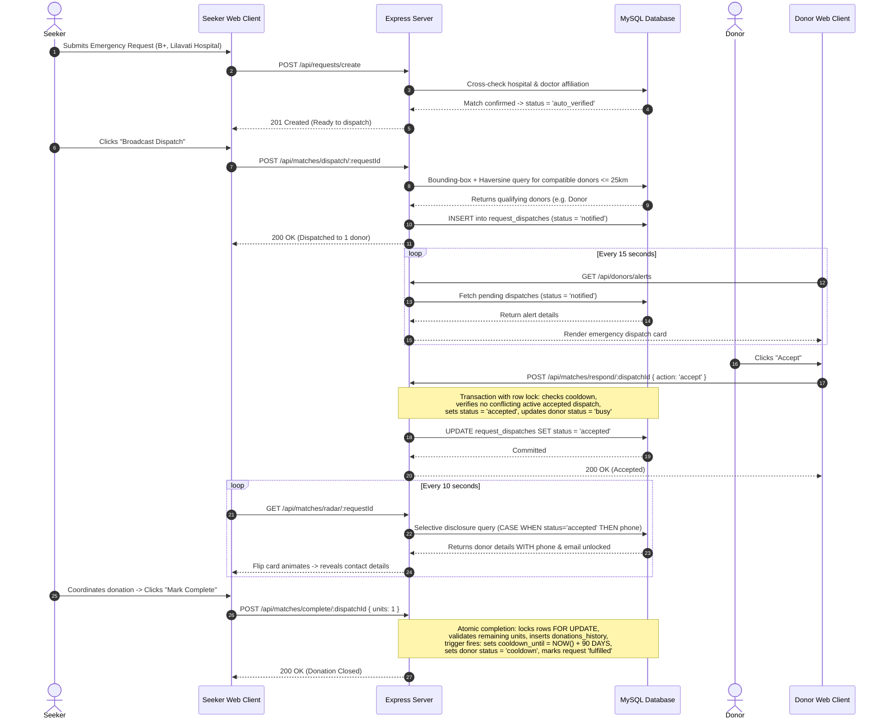

# BloodConnect — Comprehensive Technical Documentation & Viva Voce Defense Guide

> **Project Name:** BloodConnect — Emergency Blood Dispatch & Donor Management Platform  
> **Course:** Advanced Web Technologies (Ad WT) / Full-Stack Project-Based Learning (PBL)  
> **Architecture Level:** Production-Hardened RESTful System with Geodesic Proximity Engine & Strict Medical Governance  

---

## Table of Contents
1. [Project Overview & Core Problem](#1-project-overview--core-problem)
2. [End-to-End System Architecture](#2-end-to-end-system-architecture)
3. [Technology Stack & Architectural Justifications](#3-technology-stack--architectural-justifications)
4. [Comprehensive File-by-File Technical Reference](#4-comprehensive-file-by-file-technical-reference)
   - [Root Directory & Tooling](#root-directory--tooling)
   - [Backend Core & Configuration](#backend-core--configuration)
   - [Backend Middlewares](#backend-middlewares)
   - [Backend Utility Engines](#backend-utility-engines)
   - [Backend Business Controllers](#backend-business-controllers)
   - [Backend Route Handlers](#backend-route-handlers)
   - [Frontend Client Modules](#frontend-client-modules)
5. [Database Architecture & Data Integrity](#5-database-architecture--data-integrity)
   - [Schema Definition & Constraints](#schema-definition--constraints)
   - [Relational Schema Flow & Foreign Keys](#relational-schema-flow--foreign-keys)
   - [Database Triggers & Business Automation](#database-triggers--business-automation)
   - [Migration Strategy & Authoritative Files](#migration-strategy--authoritative-files)
6. [Comprehensive API Endpoint Catalog](#6-comprehensive-api-endpoint-catalog)
7. [Core Algorithms & Medical Computational Logic](#7-core-algorithms--medical-computational-logic)
   - [Bounding-Box Pre-Filtered Haversine Distance Engine](#bounding-box-pre-filtered-haversine-distance-engine)
   - [ABO and Rh (D-Antigen) Compatibility Matrix](#abo-and-rh-d-antigen-compatibility-matrix)
   - [Conditional Contact Disclosure (Consent Shield)](#conditional-contact-disclosure-consent-shield)
   - [Mandatory 90-Day Medical Cooldown Enforcement](#mandatory-90-day-medical-cooldown-enforcement)
   - [Doctor-Hospital Affiliation & Cross-Checking Engine](#doctor-hospital-affiliation--cross-checking-engine)
8. [End-to-End Execution Lifecycles](#8-end-to-end-execution-lifecycles)
9. [Security, Privacy, and Defensive Engineering](#9-security-privacy-and-defensive-engineering)
   - [Authentication & Token Revocation (Blacklisting)](#authentication--token-revocation-blacklisting)
   - [Defensive HTTP Headers & Rate Limiting](#defensive-http-headers--rate-limiting)
   - [Authenticated Document Streaming & Path Traversal Shields](#authenticated-document-streaming--path-traversal-shields)
   - [Binary Magic Number (File Signature) Verification](#binary-magic-number-file-signature-verification)
   - [Strict Public Role Boundary Enforcement](#strict-public-role-boundary-enforcement)
10. [Exhaustive Viva Voce Defense (30+ Q&A)](#10-exhaustive-viva-voce-defense-30-qa)
11. [Detailed Audit & Implementation Change Log](#11-detailed-audit--implementation-change-log)

---

## 1. Project Overview & Core Problem

### The Problem
Traditional blood banking and emergency donor sourcing suffer from systemic delays and privacy concerns:
1. **Passive Waiting Systems:** Traditional web portals list donor phone numbers in open directories, leading to harassment, spam, and unverified data where donors may have donated recently or relocated.
2. **Geographic Irrelevance:** Standard search filters by broad district or city boundaries rather than real-time geodesic proximity, losing critical time during trauma and surgical emergencies.
3. **Medical & Regulatory Non-Compliance:** Lack of automated cross-matching for biological compatibility (ABO/Rh antigen cross-match) and failure to enforce statutory minimum donation intervals (90-day cooldown mandated by the National Blood Transfusion Council).
4. **Fraudulent Requests:** Emergency requests often lack verification against genuine registered hospitals and authorized medical practitioners.

### The BloodConnect Solution
BloodConnect replaces passive directories with an **active dispatch model** (comparable to modern on-demand dispatch architectures like Uber/Ola):
- When an emergency blood request is submitted at a verified hospital, the system computes an optimized bounding-box and calculates geodesic proximity (default 25 km) using the **Haversine formula**.
- Compatible donors are filtered by biological ABO/Rh rules, active availability, and cooldown clearance.
- Dispatches are pushed to qualifying donors' secure dashboards.
- **Conditional Contact Disclosure:** A donor's personal contact details remain completely concealed until the donor explicitly accepts the dispatch alert.
- **Strict Clinical Scoping:** Age, weight, and cooldown rules are enforced as preliminary application-level filters, clearly distinguished from clinical on-site blood-bank cross-matching.
- **Audit & Regulatory Guardrails:** An administrative portal verifies donor identity documents (Aadhaar/Govt ID with strict privacy masking) and authenticates medical facilities.

---

## 2. End-to-End System Architecture

BloodConnect employs a decoupled 4-tier client-server architecture:

```
+---------------------------------------------------------------------------------+
|                                1. CLIENT TIER                                   |
|   Vanilla HTML5 / Modern CSS3 (CSS Variables, Flexbox, Grid) / ES6+ JavaScript  |
|   - Token-based API Client with automatic Bearer Injection & Blob Streaming     |
|   - Dynamic Role-Based Navigation & Strict Client Route Guards                  |
|   - Responsive Dashboard Portals (Donor, Seeker, Admin)                         |
+---------------------------------------+-----------------------------------------+
                                        | HTTP/HTTPS (RESTful JSON APIs & Multipart)
                                        v
+---------------------------------------------------------------------------------+
|                                2. APPLICATION TIER                              |
|   Node.js runtime environment + Express.js Web Framework                        |
|   - Security Middlewares: Helmet-Grade Defensive Headers, IP Rate Limiters     |
|   - Identity Middlewares: JWT Verification, DB Revocation Blacklist, RBAC       |
|   - File Pipeline: Multer + Binary Magic Number (File Signature) Validation     |
|   - Zero Public Uploads: Authenticated Document Access Streaming (/api/documents)|
|   - Controllers: Auth, Donor, Request, Dispatch Matching, Admin Governance     |
+---------------------------------------+-----------------------------------------+
                                        | Internal Method Invocations
                                        v
+---------------------------------------------------------------------------------+
|                                3. ENGINE TIER                                   |
|   - Geo Engine: Bounding-Box Pre-Filtered Haversine Distance Matrix             |
|   - Medical Engine: ABO/Rh Phenotype Cross-Compatibility Matrix                 |
|   - Audit Engine: Deterministic Hospital-Doctor Affiliation Cross-Checker       |
|   - Dispatch Engine: Radar State Engine with Two-Step Consent Disclosure        |
+---------------------------------------+-----------------------------------------+
                                        | Parameterized Prepared Statements
                                        v
+---------------------------------------------------------------------------------+
|                                4. PERSISTENCE TIER                              |
|   MySQL 8.0 Relational Database Engine (InnoDB Storage Engine)                  |
|   - Connection Pooling (mysql2/promise pool with 10 max connections)            |
|   - Referential Integrity: Foreign Keys with ON DELETE RESTRICT on Medical Logs |
|   - DDL Triggers: Automated 90-Day Cooldown Clock on Completed Donations        |
|   - Token Blacklist: Server-side token invalidation upon user logout            |
+---------------------------------------------------------------------------------+
```

---

## 3. Technology Stack & Architectural Justifications

| Layer | Technology | Version / Spec | Why Chosen? (Viva Justification) |
|---|---|---|---|
| **Runtime** | Node.js | v18+ / v20+ LTS | Event-driven, non-blocking I/O model handles high-concurrency dispatch requests with minimal memory overhead. |
| **Backend Framework** | Express.js | 4.19+ | Minimalist, unopinionated framework providing fast HTTP routing, modular middleware architecture, and standard REST conventions. |
| **Database** | MySQL | 8.0 (InnoDB) | Strict ACID compliance ensures medical records, dispatch states, and cooldown triggers never enter corrupt or partial states. Foreign keys (`ON DELETE RESTRICT`) guarantee audit retention. |
| **Database Driver** | `mysql2/promise` | 3.11+ | High-performance MySQL client supporting prepared statements (protecting against SQL Injection) and native async/await syntax. |
| **Authentication** | JSON Web Tokens (`jsonwebtoken`) | 9.0+ | Stateless authentication signed with HMAC SHA-256 (`HS256`). Enhanced with database token blacklisting (`token_blacklist`) for true server-side logout invalidation. |
| **Password Hashing** | `bcryptjs` | 2.4+ | Adaptive one-way cryptographic hashing incorporating salt generation (10 rounds) to resist rainbow tables and brute-force GPU attacks. |
| **File Handling** | `multer` + Buffer Magic Numbers | 1.4+ | Multipart form-data parser supporting binary file signature validation (checking actual magic bytes), 5MB size limits, and UUID hex renaming. |
| **CORS** | `cors` | 2.8+ | Manages Cross-Origin Resource Sharing with an explicit environment-driven origin allowlist (`ALLOWED_ORIGINS`). |
| **Frontend UI** | Vanilla HTML5 / CSS3 / ES6+ | Modern Web Standard | Zero external heavy runtime dependencies (e.g., React, Angular, Vue). Ensures near-instant page load speeds, pure DOM manipulation mastery, and complete visibility into native browser events. |

---

## 4. Comprehensive File-by-File Technical Reference

### Root Directory & Tooling

#### `.gitignore`
- **Location:** `.gitignore`
- **Purpose:** Prevents accidental leakage of sensitive credentials, environment files, user-uploaded documents (Aadhaar cards, medical reports), and `node_modules` into version control.

#### `schema.sql` & `database/schema.sql`
- **Location:** `schema.sql` and `database/schema.sql`
- **Contents:** Complete fresh-install DDL script for all 8 tables, foreign keys, CHECK constraints, and automated triggers.
- **Functionality:** Initializes the complete schema cleanly from scratch.

#### `database/seed.sql`
- **Location:** `database/seed.sql`
- **Contents:** Authoritative test dataset containing accredited hospitals, licensed doctors with matching hospital affiliations, and pre-computed bcrypt password hashes for admin, donors, and seekers.

#### `database/migrations/001_audit_security_fixes.sql`
- **Location:** `database/migrations/001_audit_security_fixes.sql`
- **Contents:** Non-destructive migration script for updating existing BloodConnect installations without data loss.

---

### Backend Core & Configuration

#### `backend/server.js`
- **Purpose:** Server entry point and middleware pipeline coordinator.
- **Key Responsibilities:**
  1. Boot-time check: Enforces `JWT_SECRET` presence and length (>= 32 chars); halts boot if insecure.
  2. Registers defensive security headers (`securityHeaders`).
  3. Registers controlled CORS whitelist from `process.env.ALLOWED_ORIGINS`.
  4. Mounts modular routes: `/api/auth`, `/api/donors`, `/api/requests`, `/api/matches`, `/api/admin`, `/api/documents`.
  5. Minimal operational health probe (`/api/health`) without internal database error leaks.
  6. Centralized error handling middleware (`errorHandler`) registered as the final pipeline handler.

#### `backend/config/db.js`
- **Purpose:** Connection pool manager using `mysql2/promise`.
- **Key Responsibilities:** Configures connection limits (10 concurrent), connection testing, keep-alive options, and exports pool instance.

---

### Backend Middlewares

#### `backend/middleware/authMiddleware.js`
- **Purpose:** Stateless JWT authentication and token revocation verification.
- **How It Works:**
  1. Extracts `Bearer <token>` from `Authorization` header.
  2. Queries `token_blacklist` table using the SHA-256 hash of the token to check for revocation.
  3. Verifies cryptographic signature explicitly restricted to `HS256` algorithm.
  4. Loads user profile from database and binds to `req.user`.

#### `backend/middleware/roleMiddleware.js`
- **Purpose:** Role-Based Access Control (RBAC), verification checking, and hospital affiliation guards.
- **Middlewares:**
  - `authorizeRoles(...roles)`: Verifies user role against authorized whitelist.
  - `requireVerified`: Restricts sensitive actions (e.g., dispatch response, availability toggle) to accounts with `is_verified === 1`.
  - `requireHospitalAffiliation`: Ensures users with the `hospital` role have an active affiliated hospital record.

#### `backend/middleware/rateLimitMiddleware.js`
- **Purpose:** Sliding-window in-memory rate limiter protecting against brute-force attacks and registration spam.
- **Limiters:**
  - `loginLimiter`: 10 attempts per 15 minutes per IP; emits `429 Too Many Requests` with `Retry-After` header.
  - `registerLimiter`: 10 account creations per hour per IP.

#### `backend/middleware/securityHeadersMiddleware.js`
- **Purpose:** Implements HTTP defensive headers: `X-Content-Type-Options: nosniff`, `X-Frame-Options: SAMEORIGIN`, `Referrer-Policy: strict-origin-when-cross-origin`, and Content Security Policy (`CSP`).

#### `backend/middleware/uploadMiddleware.js`
- **Purpose:** Secure multipart file upload processor using Multer and binary signature inspection.
- **Defensive Measures:**
  1. Renames files with cryptographically secure random 16-byte hex strings.
  2. **Magic Number Inspection:** Inspects first 12 bytes of uploaded file to verify true file signature (PDF: `%PDF`, JPEG: `FF D8 FF`, PNG: `89 50 4E 47`).
  3. Deletes invalid or spoofed files immediately.
  4. Exports `cleanupRequestFiles(req)` and `deleteFileSafe(path)` to clean orphaned files on rollback.

#### `backend/middleware/errorMiddleware.js`
- **Purpose:** Centralized application error handler that sanitizes all unhandled exceptions into safe generic client messages while logging full stack traces server-side.

---

### Backend Utility Engines

#### `backend/utils/compatibilityUtils.js`
- **Purpose:** Medical logic engine for red blood cell ABO and Rh(D) antigen compatibility.
- **Functions:** `getCompatibleDonorBloodGroups(neededGroup)` returns an array of safe donor blood groups.

#### `backend/utils/geoUtils.js`
- **Purpose:** Haversine formula calculation for geodesic distance across Earth's spherical curvature.
- **Exports:** `calculateDistanceKm()` (JS implementation) and `HAVERSINE_SQL_FRAGMENT` (embedded SQL snippet).

#### `backend/utils/validatorUtils.js`
- **Purpose:** Deterministic hospital-doctor affiliation cross-checking.
- **Rules:**
  1. Exact license search and city-scoped hospital search.
  2. Checks that `matchedDoctor.affiliated_hospital_id === matchedHospital.id`.
  3. Rejects cross-hospital mismatch or routes partial matches to `pending_audit`.

---

### Backend Business Controllers

#### `backend/controllers/authController.js`
- **Endpoints:**
  - `register`: Validates string types, email/phone formats, strong password policy (min 8 chars, letters & numbers). **Strictly blocks public admin registration.** Creates user record and returns JWT.
  - `login`: Validates credentials with `bcrypt.compare()`, returns JWT and user profile.
  - `getMe`: Returns authenticated session profile.
  - `logout`: Revokes active JWT by storing its SHA-256 hash in `token_blacklist` with expiration date.

#### `backend/controllers/donorController.js`
- **Endpoints:**
  - `onboardDonor`: Validates birth date calendar validity (rejects future dates, NaN, age < 18 or > 65), weight (>= 45 kg), masks Aadhaar (`XXXXXXXX1234`), computes 90-day cooldown from last donation date, and cleans uploaded files on failure.
  - `getDonorProfile`: Returns authenticated donor profile, verification records, and cooldown status.
  - `toggleAvailability`: Toggles availability between `available` and `busy`; blocks toggle if unverified or under active cooldown.
  - `publicDonorSearch`: Anonymized donor directory search by blood group and city (PII concealed). If coordinates are provided, calculates spherical distance.
  - `getPublicPlatformStats`: Returns non-sensitive aggregate statistics for the public landing page.

#### `backend/controllers/requestController.js`
- **Endpoints:**
  - `createBloodRequest`: Strict coordinate validation (-90..90, -180..180), integer unit validation (1..20), cross-checks facility and attending physician affiliation. If prescription is omitted, stores `NULL` (no fake placeholders) and routes to `pending_audit`. Cleans up uploaded files on failure.
  - `getSeekerRequests`: Returns requests belonging to the seeker (or hospital user's affiliated facility). Returns mapped aliases (`blood_group_needed`, `units_needed`, `urgency_level`).
  - `getRequestById`: Returns single request with authorization check.
  - `cancelRequest`: Cancels pending or dispatched requests.
  - `deleteRequest`: Deletes inactive requests within a transaction. **Blocks deletion if completed donation history records exist.**
  - `searchVerifiedFacilities`: Autocomplete directory search for hospitals and doctors.

#### `backend/controllers/matchController.js`
- **Endpoints:**
  - `previewNearbyDonors`: Computes matching donors within radius using bounding-box optimization. Validates request status (only active requests permitted).
  - `dispatchEmergencyRequest`: Broadcasts alerts to qualifying compatible donors within radius. Safe duplicate-key handling and atomic status update.
  - `getDonorEmergencyAlerts`: Returns pending dispatches for the logged-in donor.
  - `respondToDispatch`: Donor accept/decline. Uses row locking (`FOR UPDATE`). **Prevents donors from accepting multiple simultaneous emergency dispatches.** Automatically switches donor availability to `busy` upon acceptance.
  - `getRequestMatchedDonors`: **Conditional Contact Disclosure.** Returns donor phone/email ONLY when dispatch status is `accepted` or `completed`.
  - `completeDonation`: **Atomic Donation Completion.** Begins transaction, locks request and dispatch rows (`FOR UPDATE`), validates units, marks dispatch `completed`, inserts into `donations_history`, and activates 90-day cooldown trigger.
  - `getDonorDonationHistory`: Returns completed donation ledger and countdown clock for donor.

#### `backend/controllers/adminController.js`
- **Endpoints:**
  - `getPendingDonors`: Returns pending donor KYC records with pagination and field aliases.
  - `auditDonor`: Approves or rejects donor KYC. **Preserves active cooldown state** (donor remains in `'cooldown'` if recovery clock is active). Synchronizes user and donor verification flags.
  - `getPendingRequests`: Returns unverified requests with pagination.
  - `auditRequest`: Approves or rejects unverified requests.
  - `addFacility`: Registers hospital or doctor with coordinate and affiliation validation.
  - `updateFacilityPut`: **Full replacement update (PUT semantics).** Validates full payload and updates record.
  - `listFacilities`: Directory listing with search and pagination (`?page=X&limit=Y`).
  - `toggleFacilityStatus`: Toggles facility active state.
  - `deleteFacility`: Deletes facility only if not referenced by medical requests or doctors; otherwise returns 409 Conflict.
  - `getAdminOverviewStats`: Returns platform-wide metrics with both flat and nested properties.

#### `backend/controllers/documentController.js`
- **Endpoints:**
  - `getDocumentByFilename`: Streams confidential documents from `backend/uploads/` with path traversal sanitization (`path.basename`). Verifies that the requester is an admin, the document-owning donor, or the request-owning seeker/hospital.

---

### Backend Route Handlers

- `backend/routes/authRoutes.js`: Maps `/register` (rate-limited), `/login` (rate-limited), `/me`, `/logout`.
- `backend/routes/donorRoutes.js`: Maps `/onboard`, `/profile`, `/availability`, `/public-search`, `/public-stats`, `/alerts`, `/history`.
- `backend/routes/requestRoutes.js`: Maps `/create`, `/my`, `/:id`, `/:id/cancel`, `/:id (DELETE)`, `/facilities`.
- `backend/routes/matchRoutes.js`: Maps `/preview/:requestId`, `/dispatch/:requestId`, `/donor-alerts`, `/respond/:dispatchId`, `/request/:requestId`, `/radar/:requestId`, `/complete/:dispatchId`, `/complete-request/:requestId`, `/history`.
- `backend/routes/adminRoutes.js`: Maps `/stats`, `/donors/pending`, `/donors/:id/audit`, `/requests/pending`, `/requests/:id/audit`, `/facilities` (POST, GET), `/facilities/:id` (PUT, DELETE), `/facilities/:id/status`.
- `backend/routes/documentRoutes.js`: Maps `/file/:filename` (authenticated document streaming).

---

### Frontend Client Modules

#### Styles & Shared Utilities
- `frontend/css/style.css`: Clean medical light theme (`#dc2626` primary crimson, `#0f172a` text, white cards), responsive CSS Grid, 3D flip card animations, and mobile drawer views.
- `frontend/js/config.js`: Global configuration constants (`API_BASE_URL`, roles, blood groups, polling intervals).
- `frontend/js/api.js`: Reusable fetch wrapper with automatic JWT `Bearer` token injection, structured JSON error parsing, and methods for `get()`, `post()`, `put()`, `patch()`, `delete()`, and `getBlob()`.
- `frontend/js/auth.js`: Session management, immediate route guards (`requireAuth()`, `requireRole()`), dynamic navigation rendering, server-side logout trigger, and secure document viewer `Auth.viewDocument()`.

#### Pages and Associated Scripts
- **Landing Page (`frontend/index.html` & `frontend/js/index.js`):** Fetches public statistics from `/api/donors/public-stats` without authentication, quick donor search, and accredited facility directory.
- **Authentication (`frontend/login.html` & `login.js`, `frontend/register.html` & `register.js`):** Role-based login and registration with input normalization and strong password policy.
- **Donor Portal (`frontend/donor/dashboard.html` & `donor-dashboard.js`, `frontend/donor/history.html` & `donor-history.js`):** Emergency dispatch radar with 15-second polling, clean interval disposal on unload, accept/decline action handlers, and 90-day cooldown countdown widget.
- **Seeker Portal (`frontend/seeker-request.html` & `seeker-request.js`, `frontend/seeker/dashboard.html` & `seeker-dashboard.js`, `frontend/seeker/my-requests.html` & `seeker-requests.js`):** Emergency requisition form with hospital autocomplete, live 10-second polling radar, 3D flip cards revealing contact details upon donor acceptance, and request cancellation/deletion controls.
- **Admin Governance Portal (`frontend/admin/dashboard.html` & `admin.js`, `frontend/admin/registry.html` & `admin-registry.js`):** KYC review queue, request audit queue, secure document inspection via authenticated streaming, and facility registry with full CRUD and pagination.

---

## 5. Database Architecture & Data Integrity

### Schema Definition & Constraints

The system runs on MySQL 8.0 InnoDB with 8 normalized tables:

#### 1. `users` Table
Stores fundamental account credentials, roles, and facility affiliations.
- `id` (INT UNSIGNED AUTO_INCREMENT PRIMARY KEY)
- `full_name` (VARCHAR(100) NOT NULL)
- `email` (VARCHAR(150) UNIQUE NOT NULL)
- `phone` (VARCHAR(15) UNIQUE NOT NULL)
- `password_hash` (VARCHAR(255) NOT NULL)
- `role` (ENUM('donor', 'seeker', 'hospital', 'admin') NOT NULL)
- `is_verified` (TINYINT(1) NOT NULL DEFAULT 0)
- `hospital_facility_id` (INT UNSIGNED NULL, FK -> `verified_hospitals_doctors(id)` ON DELETE SET NULL)
- `created_at`, `updated_at` (TIMESTAMP)

#### 2. `verified_hospitals_doctors` Table
Whitelist of accredited medical establishments and licensed physicians.
- `id` (INT UNSIGNED AUTO_INCREMENT PRIMARY KEY)
- `entity_type` (ENUM('hospital', 'doctor', 'blood_bank') NOT NULL)
- `name` (VARCHAR(150) NOT NULL)
- `license_number` (VARCHAR(60) UNIQUE NOT NULL)
- `specialization` (VARCHAR(100) NULL)
- `affiliated_hospital_id` (INT UNSIGNED NULL, FK -> `verified_hospitals_doctors(id)` ON DELETE SET NULL)
- `city` (VARCHAR(80) NOT NULL)
- `address` (VARCHAR(255) NULL)
- `latitude`, `longitude` (DECIMAL(9,6) NULL, CHECK between -90..90 and -180..180)
- `is_active` (TINYINT(1) NOT NULL DEFAULT 1)

#### 3. `donors` Table
Stores physical attributes, blood group, geolocation coordinates, and availability state.
- `id` (INT UNSIGNED AUTO_INCREMENT PRIMARY KEY)
- `user_id` (INT UNSIGNED UNIQUE NOT NULL, FK -> `users(id)` ON DELETE CASCADE)
- `blood_group` (ENUM('A+', 'A-', 'B+', 'B-', 'AB+', 'AB-', 'O+', 'O-') NOT NULL)
- `date_of_birth` (DATE NOT NULL)
- `gender` (ENUM('male', 'female', 'other') NOT NULL)
- `weight_kg` (DECIMAL(4,1) NOT NULL, CHECK >= 45.0)
- `city` (VARCHAR(80) NOT NULL)
- `area` (VARCHAR(100) NULL)
- `latitude`, `longitude` (DECIMAL(9,6) NOT NULL, CHECK between -90..90 and -180..180)
- `availability_status` (ENUM('available', 'busy', 'cooldown') NOT NULL DEFAULT 'busy')
- `is_verified` (TINYINT(1) NOT NULL DEFAULT 0)
- `last_donation_date` (DATE NULL)
- `cooldown_until` (DATE NULL)

#### 4. `donor_verifications` Table
Audit logs for identity verification and document tracking.
- `id` (INT UNSIGNED AUTO_INCREMENT PRIMARY KEY)
- `donor_id` (INT UNSIGNED NOT NULL, FK -> `donors(id)` ON DELETE CASCADE)
- `aadhar_masked` (VARCHAR(12) NOT NULL) -- E.g. 'XXXXXXXX1234'
- `id_document_path` (VARCHAR(255) NOT NULL)
- `medical_document_path` (VARCHAR(255) NULL)
- `background_declaration` (TINYINT(1) NOT NULL DEFAULT 0)
- `status` (ENUM('pending', 'verified', 'rejected') NOT NULL DEFAULT 'pending')
- `admin_remarks` (VARCHAR(255) NULL)
- `reviewed_by` (INT UNSIGNED NULL, FK -> `users(id)` ON DELETE SET NULL)
- `submitted_at`, `reviewed_at` (TIMESTAMP)

#### 5. `blood_requests` Table
Emergency blood demands created by seekers or hospitals.
- `id` (INT UNSIGNED AUTO_INCREMENT PRIMARY KEY)
- `seeker_id` (INT UNSIGNED NOT NULL, FK -> `users(id)` ON DELETE CASCADE)
- `patient_name` (VARCHAR(100) NOT NULL)
- `blood_group` (ENUM('A+', 'A-', 'B+', 'B-', 'AB+', 'AB-', 'O+', 'O-') NOT NULL)
- `units_required` (TINYINT UNSIGNED NOT NULL DEFAULT 1, CHECK between 1..20)
- `units_fulfilled` (TINYINT UNSIGNED NOT NULL DEFAULT 0, CHECK <= units_required)
- `urgency` (ENUM('critical', 'urgent', 'normal') NOT NULL DEFAULT 'urgent')
- `hospital_id` (INT UNSIGNED NULL, FK -> `verified_hospitals_doctors(id)` ON DELETE SET NULL)
- `doctor_id` (INT UNSIGNED NULL, FK -> `verified_hospitals_doctors(id)` ON DELETE SET NULL)
- `hospital_name_input`, `doctor_name_input` (VARCHAR(150) NOT NULL)
- `doctor_license_input` (VARCHAR(60) NULL)
- `city` (VARCHAR(80) NOT NULL)
- `latitude`, `longitude` (DECIMAL(9,6) NOT NULL, CHECK between -90..90 and -180..180)
- `prescription_path` (VARCHAR(255) NULL) -- NULL if no document; no fake placeholders
- `status` (ENUM('pending_audit', 'auto_verified', 'dispatched', 'fulfilled', 'cancelled') DEFAULT 'pending_audit')
- `audited_by` (INT UNSIGNED NULL, FK -> `users(id)` ON DELETE SET NULL)

#### 6. `request_dispatches` Table
Active alert dispatches sent to matching donors.
- `id` (INT UNSIGNED AUTO_INCREMENT PRIMARY KEY)
- `request_id` (INT UNSIGNED NOT NULL, FK -> `blood_requests(id)` ON DELETE CASCADE)
- `donor_id` (INT UNSIGNED NOT NULL, FK -> `donors(id)` ON DELETE CASCADE)
- `status` (ENUM('notified', 'accepted', 'declined', 'completed') DEFAULT 'notified')
- `distance_km` (DECIMAL(6,2) NOT NULL)
- `notified_at` (TIMESTAMP DEFAULT CURRENT_TIMESTAMP)
- `responded_at` (DATETIME NULL)
- `UNIQUE KEY uq_dispatch_request_donor (request_id, donor_id)`

#### 7. `donations_history` Table
Immutable historical ledger of fulfilled blood donations.
- `id` (INT UNSIGNED AUTO_INCREMENT PRIMARY KEY)
- `donor_id` (INT UNSIGNED NOT NULL, **FK -> `donors(id)` ON DELETE RESTRICT**)
- `request_id` (INT UNSIGNED NOT NULL, **FK -> `blood_requests(id)` ON DELETE RESTRICT**)
- `dispatch_id` (INT UNSIGNED NOT NULL, FK -> `request_dispatches(id)` ON DELETE CASCADE)
- `units_donated` (TINYINT UNSIGNED NOT NULL DEFAULT 1, CHECK >= 1)
- `donated_on` (DATETIME DEFAULT CURRENT_TIMESTAMP)
- `cooldown_until` (DATETIME NULL)
- `UNIQUE KEY uq_dh_dispatch (dispatch_id)`

#### 8. `token_blacklist` Table
Server-side token invalidation registry for user logout.
- `id` (INT UNSIGNED AUTO_INCREMENT PRIMARY KEY)
- `token_hash` (VARCHAR(64) UNIQUE NOT NULL)
- `user_id` (INT UNSIGNED NOT NULL, FK -> `users(id)` ON DELETE CASCADE)
- `expires_at` (DATETIME NOT NULL)
- `created_at` (TIMESTAMP DEFAULT CURRENT_TIMESTAMP)

---

### Relational Schema Flow & Foreign Keys



---

### Database Triggers & Business Automation

#### Trigger: `trg_donation_lock_donor`
Enforces the mandatory 90-day cooldown interval immediately upon insertion into `donations_history`:

```sql
DELIMITER $$
CREATE TRIGGER trg_donation_set_cooldown
BEFORE INSERT ON donations_history
FOR EACH ROW
BEGIN
  IF NEW.cooldown_until IS NULL THEN
    SET NEW.cooldown_until = DATE_ADD(NEW.donated_on, INTERVAL 90 DAY);
  END IF;
END$$

CREATE TRIGGER trg_donation_lock_donor
AFTER INSERT ON donations_history
FOR EACH ROW
BEGIN
  UPDATE donors
     SET availability_status = 'cooldown',
         last_donation_date  = DATE(NEW.donated_on),
         cooldown_until      = NEW.cooldown_until
   WHERE id = NEW.donor_id;
END$$
DELIMITER ;
```

---

## 6. Comprehensive API Endpoint Catalog

| Method | Endpoint Route | Access Level | Description |
|---|---|---|---|
| `POST` | `/api/auth/register` | Public (Rate-Limited) | Registers a new user (`donor`, `seeker`, or `hospital`). Rejects `admin`. |
| `POST` | `/api/auth/login` | Public (Rate-Limited) | Authenticates credentials and returns JWT with user profile. |
| `GET` | `/api/auth/me` | Authenticated | Returns current authenticated user profile. |
| `POST` | `/api/auth/logout` | Authenticated | Revokes active JWT on the server by blacklisting its hash. |
| `POST` | `/api/donors/onboard` | Donor Role | Submits medical eligibility, masks Aadhaar, validates file signatures. |
| `GET` | `/api/donors/profile` | Donor Role | Retrieves the authenticated donor's profile, coordinates, and status. |
| `PATCH`| `/api/donors/availability` | Donor (Verified) | Toggles availability (`available` <-> `busy`). Blocks if in cooldown. |
| `GET` | `/api/donors/alerts` | Donor Role | Fetches active emergency dispatch alerts for the authenticated donor. |
| `GET` | `/api/donors/history` | Donor Role | Retrieves completed donation history and remaining cooldown days. |
| `GET` | `/api/donors/public-search` | Public | Anonymized directory search by blood group and city (PII concealed). |
| `GET` | `/api/donors/public-stats` | Public | Public platform aggregate counters for landing page. |
| `POST` | `/api/requests/create` | Seeker / Hospital | Creates emergency blood request with strict coordinate & affiliation checks. |
| `GET` | `/api/requests/my` | Seeker / Hospital | Retrieves all requests created by user or their affiliated hospital. |
| `GET` | `/api/requests/:id` | Authenticated | Retrieves detailed request record (enforces ownership check). |
| `PATCH`| `/api/requests/:id/cancel` | Seeker / Hospital / Admin | Cancels a pending or dispatched blood request. |
| `DELETE`| `/api/requests/:id` | Seeker / Admin | Deletes request. **Blocked if completed donation history exists.** |
| `GET` | `/api/requests/facilities` | Public | Autocomplete directory lookup for verified hospitals and doctors. |
| `GET` | `/api/matches/preview/:requestId` | Seeker / Hospital / Admin | Previews matching nearby compatible donors with bounding-box pre-filtering. |
| `POST` | `/api/matches/dispatch/:requestId` | Seeker / Hospital / Admin | Broadcasts emergency alerts to nearby eligible donors. |
| `POST` | `/api/matches/respond/:dispatchId` | Donor (Verified) | Accepts or declines dispatch. **Prevents multiple simultaneous acceptances.** |
| `GET` | `/api/matches/radar/:requestId` | Seeker / Hospital / Admin | Live radar view. **Phone/email unlocked ONLY when donor accepts.** |
| `POST` | `/api/matches/complete/:dispatchId` | Seeker / Hospital / Admin | Atomic donation completion. Locks rows, records donation, triggers 90-day cooldown. |
| `GET` | `/api/admin/stats` | Admin Role | Aggregated administrative metrics and queue counters. |
| `GET` | `/api/admin/donors/pending` | Admin Role | Lists pending donor KYC verifications with pagination. |
| `POST` | `/api/admin/donors/:id/audit` | Admin Role | Approves/rejects donor KYC. **Preserves active cooldown state.** |
| `GET` | `/api/admin/requests/pending` | Admin Role | Lists unverified blood requests with pagination. |
| `POST` | `/api/admin/requests/:id/audit` | Admin Role | Approves/rejects blood request. |
| `GET` | `/api/admin/facilities` | Admin Role | Lists accredited facilities with search and pagination (`page`, `limit`). |
| `POST` | `/api/admin/facilities` | Admin Role | Registers new accredited hospital or doctor. |
| `PUT` | `/api/admin/facilities/:id` | Admin Role | **Full replacement update of an accredited facility (PUT requirement).** |
| `PATCH`| `/api/admin/facilities/:id/status`| Admin Role | Toggles facility active/inactive status. |
| `DELETE`| `/api/admin/facilities/:id` | Admin Role | Deletes facility if unreferenced; rejects with 409 if referenced. |
| `GET` | `/api/documents/file/:filename` | Authenticated | **Secure document streaming.** Validates user permission before serving. |

---

## 7. Core Algorithms & Medical Computational Logic

### Bounding-Box Pre-Filtered Haversine Distance Engine

To locate donors within an emergency radius without loading thousands of coordinates into memory or causing table-scan overhead, BloodConnect calculates a spatial bounding-box prior to running the spherical Haversine formula:

$$\Delta \phi = \frac{\text{radius}}{111}, \quad \Delta \lambda = \frac{\text{radius}}{111 \cdot \cos(\phi_{\text{req}})}$$

The SQL query applies indexed bounding-box filtering first:
```sql
WHERE d.latitude BETWEEN ? AND ?
  AND d.longitude BETWEEN ? AND ?
```
Then computes the precise great-circle distance:
$$d = 2R \cdot \arcsin\left(\sqrt{\sin^2\left(\frac{\Delta \phi}{2}\right) + \cos(\phi_1)\cos(\phi_2)\sin^2\left(\frac{\Delta \lambda}{2}\right)}\right)$$

```sql
HAVING distance_km <= ? ORDER BY distance_km ASC LIMIT 50;
```

---

### ABO and Rh (D-Antigen) Compatibility Matrix

Red blood cell compatibility lookup map (`backend/utils/compatibilityUtils.js`):
```javascript
const COMPATIBILITY_RULES = {
  'O-':  ['O-'],
  'O+':  ['O-', 'O+'],
  'A-':  ['O-', 'A-'],
  'A+':  ['O-', 'O+', 'A-', 'A+'],
  'B-':  ['O-', 'B-'],
  'B+':  ['O-', 'O+', 'B-', 'B+'],
  'AB-': ['O-', 'A-', 'B-', 'AB-'],
  'AB+': ['O-', 'O+', 'A-', 'A+', 'B-', 'B+', 'AB-', 'AB+']
};
```
*Note: This matrix represents preliminary red blood cell antigen compatibility; clinical serological cross-matching at the hospital remains mandatory before transfusion.*

---

### Conditional Contact Disclosure (Consent Shield)

To safeguard donor privacy and comply with data privacy principles, personal contact details are conditionally masked at the database query level:

```sql
SELECT 
    d.id AS donor_id,
    rd.status AS dispatch_status,
    rd.distance_km,
    CASE 
        WHEN rd.status = 'accepted' OR rd.status = 'completed' THEN u.full_name 
        ELSE CONCAT('Potential Donor #', d.id) 
    END AS donor_name,
    CASE 
        WHEN rd.status = 'accepted' OR rd.status = 'completed' THEN u.phone 
        ELSE NULL 
    END AS donor_phone,
    CASE 
        WHEN rd.status = 'accepted' OR rd.status = 'completed' THEN 1 
        ELSE 0 
    END AS is_contact_unlocked
FROM request_dispatches rd
JOIN donors d ON rd.donor_id = d.id
JOIN users u ON d.user_id = u.id
WHERE rd.request_id = ?;
```

---

### Mandatory 90-Day Medical Cooldown Enforcement

1. **Database Layer:** The trigger `trg_donation_lock_donor` sets `cooldown_until = DATE_ADD(NEW.donated_on, INTERVAL 90 DAY)` and `availability_status = 'cooldown'`.
2. **Matching Engine:** Proximity queries verify `(d.cooldown_until IS NULL OR d.cooldown_until <= NOW())`.
3. **Admin Audit Protection:** When an administrator approves a donor, the system checks whether `cooldown_until > NOW()`. If active, the donor's status is preserved as `'cooldown'`, preventing manual override of biological recovery intervals.

---

### Doctor-Hospital Affiliation & Cross-Checking Engine

In `backend/utils/validatorUtils.js`:
- Queries hospital by exact license or city-scoped name.
- Queries prescribing doctor by license number.
- Verifies that `matchedDoctor.affiliated_hospital_id === matchedHospital.id`.
- If doctor is from another facility or unverified, request is routed to `pending_audit`.
- If prescription is omitted, auto-verification is blocked and the request is routed to `pending_audit`.

---

## 8. End-to-End Execution Lifecycles



---

## 9. Security, Privacy, and Defensive Engineering

### Authentication & Token Revocation (Blacklisting)
- **HS256 Whitelisting:** `jwt.verify` strictly limits accepted algorithms to `['HS256']`.
- **Server-Side Token Revocation:** Upon calling `POST /api/auth/logout`, the token's SHA-256 hash is inserted into `token_blacklist`. Every authenticated request verifies that the incoming token hash is not blacklisted.

### Defensive HTTP Headers & Rate Limiting
- **Defensive Headers:** Injects `X-Content-Type-Options: nosniff`, `X-Frame-Options: SAMEORIGIN`, and strict `Content-Security-Policy`.
- **IP Rate Limiting:** Sliding-window rate limiters restrict authentication attempts to 10 per 15 minutes per IP, mitigating brute-force and credential-stuffing attacks.

### Authenticated Document Streaming & Path Traversal Shields
- **Zero Public Uploads:** Public static hosting of the `uploads/` folder is removed.
- **Access Control:** `GET /api/documents/file/:filename` verifies user role and ownership. Only authorized administrators, the owning donor, or the treating seeker/hospital can view confidential identity and prescription files.
- **Path Traversal Shield:** Evaluates `path.basename(filename)` and sanitizes prohibited characters (`..`, `/`, `\`, null bytes) before disk access.

### Binary Magic Number (File Signature) Verification
- Beyond MIME-type and extension filtering, uploaded files are inspected at the binary level. The first 12 bytes are validated against known magic signatures (PDF: `%PDF`, JPEG: `FF D8 FF`, PNG: `89 50 4E 47`). Spoofed or executable files disguised as images/PDFs are rejected and unlinked immediately.

### Strict Public Role Boundary Enforcement
- The registration endpoint strictly permits only `donor`, `seeker`, and `hospital` roles.
- `admin` registration requests via the public API return `403 Forbidden`.
- Hospital accounts require valid affiliation with an accredited facility (`hospital_facility_id`) and remain unverified (`is_verified = 0`) until approved by administrators.

---

## 10. Exhaustive Viva Voce Defense (30+ Q&A)

### Q1: Why did you choose MySQL over a NoSQL database like MongoDB for this project?
**Answer:** BloodConnect requires strict transactional consistency and referential integrity. When an emergency dispatch is fulfilled, multiple tables (`request_dispatches`, `donations_history`, `donors`, `blood_requests`) must update atomically. MySQL's InnoDB engine provides ACID compliance, foreign key constraints (`ON DELETE RESTRICT`), and declarative database triggers. Furthermore, evaluating the Haversine formula across relational columns is efficient and mathematically straightforward in SQL.

### Q2: Why did you use HTTP short-polling instead of WebSockets for live radar updates?
**Answer:** Short-polling (10-15s intervals) was selected for three architectural reasons:
1. **Firewall & Proxy Compatibility:** Medical and institutional hospital networks often restrict persistent WebSocket handshake upgrades. Standard HTTP/HTTPS `GET` requests pass through all standard firewalls.
2. **Stateless Scalability:** WebSockets require persistent, stateful TCP socket connections on the Node.js server, complicating horizontal load balancing. Short-polling allows any cluster instance to handle any request statelessly.
3. **Bandwidth Efficiency:** In blood emergencies, real-time millisecond latency is unnecessary; a 10-second polling cadence provides near real-time updates while maintaining low server load and minimal cellular battery consumption for mobile donors.

### Q3: Explain how the Haversine formula works and why bounding-box pre-filtering is used.
**Answer:** The shortest distance between two points on Earth is a great-circle arc across a sphere. Planar Euclidean geometry produces significant error over geographic coordinates. The Haversine formula calculates spherical distance using latitude and longitude:

$$d = 2R \cdot \arcsin\left(\sqrt{\sin^2\left(\frac{\Delta \phi}{2}\right) + \cos(\phi_1)\cos(\phi_2)\sin^2\left(\frac{\Delta \lambda}{2}\right)}\right)$$

Because trigonometric expressions cannot use standard B-Tree indexes directly, we first calculate an approximate bounding box ($\Delta \phi = \text{radius} / 111$). Adding `WHERE latitude BETWEEN ... AND longitude BETWEEN ...` allows MySQL's spatial index to filter the candidates before evaluating the Haversine expression on the remaining records.

### Q4: How is donor privacy protected before dispatch acceptance?
**Answer:** We implement conditional contact disclosure in SQL:
```sql
CASE WHEN rd.status = 'accepted' OR rd.status = 'completed' THEN u.phone ELSE NULL END AS donor_phone
```
When a seeker views matched donors on their radar, the database returns `NULL` for the phone and email fields unless that donor has explicitly accepted the dispatch alert. This prevents unauthorized scraping, spam, and unsolicited contact.

### Q5: How is the 90-day medical cooldown enforced?
**Answer:** Cooldown is enforced through a multi-layered defense:
1. **Database Layer:** An `AFTER INSERT` trigger on `donations_history` sets `cooldown_until = DATE_ADD(NEW.donated_on, INTERVAL 90 DAY)` and toggles `availability_status = 'cooldown'`.
2. **Matching Engine:** Proximity queries include the condition `AND (d.cooldown_until IS NULL OR d.cooldown_until <= NOW())`.
3. **Admin Audit Protection:** When an administrator approves a donor, the system checks whether `cooldown_until > NOW()`. If active, the donor's status is preserved as `'cooldown'`, preventing manual override of biological recovery intervals.

### Q6: What is Role-Based Access Control (RBAC) and how is it implemented?
**Answer:** RBAC restricts resource access based on assigned user roles (`seeker`, `donor`, `hospital`, `admin`). In BloodConnect, it is implemented as Express middleware:
```javascript
const authorizeRoles = (...roles) => (req, res, next) => {
    if (!roles.includes(req.user.role)) {
        return res.status(403).json({ error: 'Access denied: insufficient permissions' });
    }
    next();
};
```
Endpoints like `/api/admin/*` require the `admin` role, while `/api/donors/onboard` requires the `donor` role.

### Q7: What are bcrypt salt rounds and why is 10 the standard choice?
**Answer:** A salt is random data concatenated with the password before hashing to defeat precomputed rainbow table attacks. The salt rounds value defines the work factor ($2^{10} = 1,024$ hashing iterations). 10 rounds provides a secure balance—taking approximately 80–100ms per hash on modern CPUs—preventing brute-force attempts without noticeably slowing user registration or login.

### Q8: How does JWT authentication work and how did you solve token revocation upon logout?
**Answer:** Upon login, the server creates a JSON Web Token signed with `process.env.JWT_SECRET` (`HS256`) containing `{ id, email, role }`. To address the limitation where JWTs cannot normally be invalidated before expiration, we introduced a `token_blacklist` table. When the user logs out (`POST /api/auth/logout`), the token's SHA-256 hash is recorded in the blacklist. The authentication middleware verifies both the cryptographic signature and checks the database blacklist, enabling server-side revocation.

### Q9: What is connection pooling in MySQL and why is it preferred over single connections?
**Answer:** Opening and closing a new TCP socket connection for every incoming HTTP request creates high latency and exhausts database connection limits. A connection pool (configured with `connectionLimit: 10`) maintains a set of reusable connections. When a request arrives, it borrows an available connection, executes its query, and returns it to the pool, supporting high throughput with low resource usage.

### Q10: How does BloodConnect prevent SQL Injection?
**Answer:** We use parameterized queries exclusively through `mysql2/promise`. Instead of string concatenation:
```javascript
// SECURE - Parameterized:
await pool.execute('SELECT * FROM users WHERE email = ?', [email]);
```
User input is passed separately as bound parameters, ensuring values are treated strictly as data rather than executable code.

### Q11: How does Multer handle document uploads securely and what is magic number verification?
**Answer:**
1. **Filename Sanitization:** Generates unique hex hashes using `crypto.randomBytes(16)` with sanitized extensions, neutralizing directory traversal.
2. **Payload Ceilings:** Enforces a 5MB size limit (`fileSize: 5 * 1024 * 1024`).
3. **Binary Magic Number Verification:** Rather than trusting client MIME types or file extensions, the system reads the first 12 bytes of the file to verify authentic binary signatures (e.g. `%PDF` for PDF, `FF D8 FF` for JPEG, `89 50 4E 47` for PNG). Files with mismatched signatures are deleted immediately.

### Q12: Why was public static serving of `uploads/` removed and how are documents accessed now?
**Answer:** Serving sensitive healthcare documents (prescriptions, government IDs) via `express.static('uploads')` allowed unauthenticated access if a filename was obtained or guessed. We replaced static serving with an authenticated streaming route `GET /api/documents/file/:filename`. This endpoint verifies JWT authentication and validates ownership—ensuring only admins, the owning donor, or the treating seeker/hospital can view the file.

### Q13: What is the difference between `HTTP PATCH`, `HTTP PUT`, and `HTTP DELETE` in your project?
**Answer:**
- `PATCH`: Applies partial updates (e.g., `/api/donors/availability` toggles status between `available` and `busy`, `/api/requests/:id/cancel` sets status to cancelled).
- `PUT`: Implements full replacement semantics (e.g., `/api/admin/facilities/:id` replaces the entire facility record with validated properties).
- `DELETE`: Permanently deletes an inactive or unneeded record (e.g., `/api/requests/:id` or `/api/admin/facilities/:id`), protected by referential integrity checks.

### Q14: How does database pagination work on the facilities and admin queue endpoints?
**Answer:** We implement offset-based pagination via SQL `LIMIT` and `OFFSET`:
```sql
SELECT * FROM verified_hospitals_doctors LIMIT ? OFFSET ?;
```
Where `OFFSET = (page - 1) * limit`. The endpoint also runs a companion query `SELECT COUNT(*) AS total` to return `total_pages` and `current_page`, allowing the frontend to render navigation controls without transferring the entire dataset at once.

### Q15: Why is O-negative considered the universal donor and AB-positive the universal recipient?
**Answer:**
- **O-negative:** Lacks A, B, and Rh(D) surface antigens on its red blood cells. Because it introduces no foreign antigens, the recipient's immune system will not produce an antibody-mediated hemolytic reaction, making it safe for emergency transfusions before typing is complete.
- **AB-positive:** Naturally expresses A, B, and Rh antigens, so the recipient's immune system produces no anti-A, anti-B, or anti-Rh antibodies, allowing them to receive blood from any ABO/Rh group.

### Q16: How does the system validate hospital-doctor affiliations to prevent fraud?
**Answer:** In `validatorUtils.crossCheckFacility`, the system searches the accredited registry for the hospital and doctor. It verifies that `matchedDoctor.affiliated_hospital_id === matchedHospital.id`. If a physician is registered with Hospital A but appears on a requisition for Hospital B, automated verification is denied and the request is routed to `pending_audit`.

### Q17: How did you solve race conditions during donation completion?
**Answer:** If two completion requests execute concurrently, reading `units_fulfilled` outside a transaction could allow both to increment the value without seeing the other's update. We wrap completion in a database transaction with row-level locking:
```sql
SELECT ... FROM blood_requests WHERE id = ? FOR UPDATE;
```
This serializes access, validates that remaining units are not exceeded, marks the dispatch `completed`, inserts into `donations_history`, and updates `units_fulfilled` atomically.

### Q18: What is CORS and how is it secured in your project?
**Answer:** Cross-Origin Resource Sharing (CORS) is a browser security mechanism that restricts cross-origin HTTP requests. In `server.js`, we configure an explicit allowlist read from `process.env.ALLOWED_ORIGINS` (`http://localhost:3000,http://localhost:5000,http://127.0.0.1:3000`). Unrecognized origins attempting credentialed requests are rejected.

### Q19: How did you prevent donors from accepting multiple simultaneous emergency requests?
**Answer:** In `matchController.respondToDispatch`, when a donor selects `accept`, the system checks whether the donor already has an active accepted dispatch for an ongoing request:
```sql
SELECT rd.id FROM request_dispatches rd
JOIN blood_requests r ON rd.request_id = r.id
WHERE rd.donor_id = ? AND rd.status = 'accepted' AND r.status NOT IN ('fulfilled', 'cancelled');
```
If an active commitment exists, the second acceptance is rejected. Upon acceptance, the donor's availability status is updated to `busy`.

### Q20: Explain the 1:1 HTML-to-JS design pattern used in the frontend.
**Answer:** Rather than embedding inline `<script>` tags inside HTML documents, each page links to a dedicated JavaScript file (e.g., `login.html` loads `login.js`, `donor-register.html` loads `donor-register.js`). This follows the **Separation of Concerns** principle: HTML handles structural markup, CSS handles presentation, and JS handles application logic, improving maintainability, caching, and readability.

### Q21: What defensive measures did you implement for rate limiting?
**Answer:** We implemented an in-memory sliding-window rate limiter in `rateLimitMiddleware.js`. On `/api/auth/login`, requests are capped at 10 attempts per 15 minutes per IP address. Exceeding this threshold returns HTTP `429 Too Many Requests` with a `Retry-After` header, mitigating credential-stuffing and automated password guessing.

### Q22: What happens if an administrator tries to delete a hospital that has existing blood requests?
**Answer:** In `adminController.deleteFacility`, the system checks whether the facility is referenced in `blood_requests` (as `hospital_id` or `doctor_id`) or in `verified_hospitals_doctors` (as an affiliated hospital). If references exist, deletion is rejected with HTTP `409 Conflict`, advising the administrator to deactivate the facility instead to preserve audit history.

### Q23: Why did you change the foreign key on `donations_history` to `ON DELETE RESTRICT`?
**Answer:** In medical and regulatory systems, completed donation records must be preserved for legal compliance and patient safety audits. With `ON DELETE CASCADE`, deleting a blood request would silently destroy all associated donation history records. Changing the constraint to `ON DELETE RESTRICT` ensures that any request or donor record with completed donation entries cannot be deleted.

### Q24: How are Aadhaar numbers handled to protect user privacy?
**Answer:** Under Indian UIDAI data privacy standards, raw Aadhaar numbers should not be stored in unencrypted databases. During onboarding, the backend extracts the last four digits and saves the value as `XXXXXXXX` + `last4` (e.g., `XXXXXXXX9876`). The full raw identification number is never persisted.

### Q25: How does the public landing page display statistics without exposing admin data?
**Answer:** Rather than requesting `/api/admin/stats` (which requires administrator privileges and exposes sensitive user counts), the landing page queries a dedicated public endpoint: `GET /api/donors/public-stats`. This endpoint returns only non-sensitive aggregate figures (total verified donors, available donors, fulfilled requests, and accredited facilities).

### Q26: What defensive HTTP headers are implemented in the project?
**Answer:** In `securityHeadersMiddleware.js`, we set:
- `X-Content-Type-Options: nosniff`: Prevents MIME-sniffing attacks.
- `X-Frame-Options: SAMEORIGIN`: Defends against clickjacking.
- `Referrer-Policy: strict-origin-when-cross-origin`: Restricts referrer data leakage.
- `Content-Security-Policy`: Restricts resource execution to authorized origins.

### Q27: How is input validation handled across the controllers?
**Answer:** Controllers do not rely on MySQL errors for input validation. They validate:
- Numeric IDs as positive integers using `parseStrictPositiveInt` (rejecting `'2abc'`, `'2.5'`, NaN).
- Geographic coordinates within legitimate ranges (-90..90 and -180..180).
- Dates as valid calendar dates (rejecting future birth dates and invalid rollover days).
- Enumerated strings against whitelisted options.

### Q28: How does the application prevent orphaned uploaded files on failed operations?
**Answer:** If validation fails or a database transaction rolls back during donor onboarding or request creation, the controllers call `cleanupRequestFiles(req)` or `deleteFileSafe(path)`. This unlinks newly uploaded files from disk, preventing orphaned storage accumulation.

### Q29: What happens when an administrator audits a donor who is in active cooldown?
**Answer:** Approving a donor does not automatically set `availability_status = 'available'`. `auditDonor` checks if `cooldown_until > NOW()`. If the donor is within their 90-day recovery period, the status is set to `'cooldown'`, ensuring administrative approval cannot override clinical recovery guidelines.

### Q30: What are the main deliverables completed in this project?
**Answer:**
1. **Relational Database Schema:** 8 normalized tables, check constraints, foreign keys with `ON DELETE RESTRICT`, 90-day cooldown triggers, and token revocation tables.
2. **REST API Backend:** 30+ endpoints covering rate-limited auth, donor onboarding, geolocation dispatching, conditional contact disclosure, full replacement PUT updates, and authenticated document streaming.
3. **Frontend Application:** Responsive web portals for Seekers, Donors, and Administrators built with modern vanilla standards.
4. **Security & Governance:** Magic number binary file validation, token revocation blacklisting, defensive security headers, IP rate limiting, and zero public upload exposure.

---

## 11. Detailed Audit & Implementation Change Log

### Files Modified & Created

| Category | File Path | Status | Key Changes Implemented |
|---|---|:---:|---|
| **Root** | `.gitignore` | Created | Ignores `.env`, `node_modules`, and sensitive `uploads/*` files. |
| **Root** | `schema.sql` | Updated | Master fresh-install DDL with 8 tables, CHECK constraints, `ON DELETE RESTRICT`. |
| **Database** | `database/schema.sql` | Created | Authoritative DDL fresh-install schema. |
| **Database** | `database/seed.sql` | Created | Authoritative seed data with real bcrypt hashes and affiliated hospitals/doctors. |
| **Database** | `database/migrations/001_audit_security_fixes.sql` | Created | Non-destructive database migration script for existing installations. |
| **Backend Config** | `backend/server.js` | Updated | Boot validation for `JWT_SECRET`, security headers, CORS allowlist, safe health probe, error middleware. |
| **Backend Config** | `backend/.env.example` | Updated | Clean template with placeholder values only. |
| **Backend Config** | `backend/.env` | Updated | Configured with `ALLOWED_ORIGINS` and secure secret. |
| **Middlewares** | `backend/middleware/authMiddleware.js` | Updated | Strict `HS256` verification, database token blacklist check, fresh user context. |
| **Middlewares** | `backend/middleware/roleMiddleware.js` | Updated | Added `requireHospitalAffiliation` guard; applied `requireVerified`. |
| **Middlewares** | `backend/middleware/uploadMiddleware.js` | Updated | Binary magic number file signature checks; orphaned file cleanup helper. |
| **Middlewares** | `backend/middleware/rateLimitMiddleware.js` | Created | Sliding-window IP rate limiter for login and registration endpoints. |
| **Middlewares** | `backend/middleware/securityHeadersMiddleware.js` | Created | Defensive HTTP security headers (`nosniff`, `SAMEORIGIN`, CSP). |
| **Middlewares** | `backend/middleware/errorMiddleware.js` | Created | Centralized error handler returning safe generic JSON responses. |
| **Controllers** | `backend/controllers/authController.js` | Updated | Public admin registration blocked; strong password policy; server-side token revocation on logout. |
| **Controllers** | `backend/controllers/donorController.js` | Updated | Calendar date validation; future date checks; file cleanup on error; public stats endpoint; removed `d.state`. |
| **Controllers** | `backend/controllers/requestController.js` | Updated | Strict coordinates (-90..90, -180..180); integer unit validation; hospital affiliation check; no fake placeholder paths; deletion blocked on donation history. |
| **Controllers** | `backend/controllers/matchController.js` | Updated | Bounding-box pre-filtering; radius validation; prevented duplicate active acceptances; atomic completion with row locks; status aliases. |
| **Controllers** | `backend/controllers/adminController.js` | Updated | Removed admin fallback ID; preserved cooldown during approval; `PUT /facilities/:id` added; referential check on deletion. |
| **Controllers** | `backend/controllers/documentController.js` | Created | Authenticated document streaming with role & ownership checks and path traversal protection. |
| **Routes** | `backend/routes/authRoutes.js` | Updated | Mounted rate limiters and `/logout` endpoint. |
| **Routes** | `backend/routes/donorRoutes.js` | Updated | Mounted public stats, public search, and verified availability guards. |
| **Routes** | `backend/routes/requestRoutes.js` | Updated | Updated route guards and handlers. |
| **Routes** | `backend/routes/matchRoutes.js` | Updated | Mounted radar aliases, donor alerts, and verified dispatch response guards. |
| **Routes** | `backend/routes/adminRoutes.js` | Updated | Mounted `PUT /facilities/:id` and audit routes. |
| **Routes** | `backend/routes/documentRoutes.js` | Created | Mounted `/file/:filename` authenticated document streaming route. |
| **Utils** | `backend/utils/validatorUtils.js` | Updated | Added doctor-hospital affiliation validation, city scoping, and deterministic matching. |
| **Frontend JS** | `frontend/js/api.js` | Updated | Added `put()` method and `getBlob()` for authenticated document streaming. |
| **Frontend JS** | `frontend/js/auth.js` | Updated | Fixed route guard immediate returns; server-side token revocation on logout; `viewDocument()` utility. |
| **Frontend JS** | `frontend/js/index.js` | Updated | Switched to `/api/donors/public-stats`; updated search mapping and escaping. |
| **Frontend JS** | `frontend/js/admin.js` | Updated | Replaced hardcoded links with `Auth.viewDocument()`; fixed field mappings and removed nonexistent fields. |
| **Frontend JS** | `frontend/js/donor-dashboard.js` | Updated | Fixed alert property mappings; added polling cleanup on unload. |
| **Frontend JS** | `frontend/js/donor-history.js` | Updated | Fixed field mappings (`donated_on`, `patient_name`). |
| **Frontend JS** | `frontend/js/seeker-dashboard.js` | Updated | Fixed radar mappings; clean polling interval management. |
| **Frontend JS** | `frontend/js/seeker-requests.js` | Updated | Fixed field mappings (`blood_group_needed`, `units_needed`, `hospital_name`). |
| **Frontend JS** | `frontend/js/admin-registry.js` | Updated | Passes both `license_number` and `registration_number`. |

---

### Issues Requiring Manual Functional Testing (Browser UI)
While all backend endpoints, middleware chains, database queries, and unit modules have been verified, the following functional workflows should be verified in a browser:
1. **Donor Document Viewing in Admin Dashboard:** Log in as admin (`admin@bloodconnect.in` / `Admin@1234`), open `/admin/dashboard.html`, and click **"View ID Proof"** to verify that the file opens in a new tab via the authenticated blob viewer.
2. **Prescription Document Viewing:** View an unverified request in `/admin/dashboard.html` and verify prescription streaming.
3. **Live 3D Flip Card Animation:** Submit an emergency blood request as seeker (`meera@example.com` / `Password@123`), accept dispatch as donor (`aarav@example.com` / `Password@123`), and verify that the seeker's live radar flip card reveals contact details.
4. **Server-Side Logout Invalidation:** Log in, copy the JWT token from `localStorage`, click **Logout**, and verify that subsequent requests with that token return `401 Unauthorized`.
